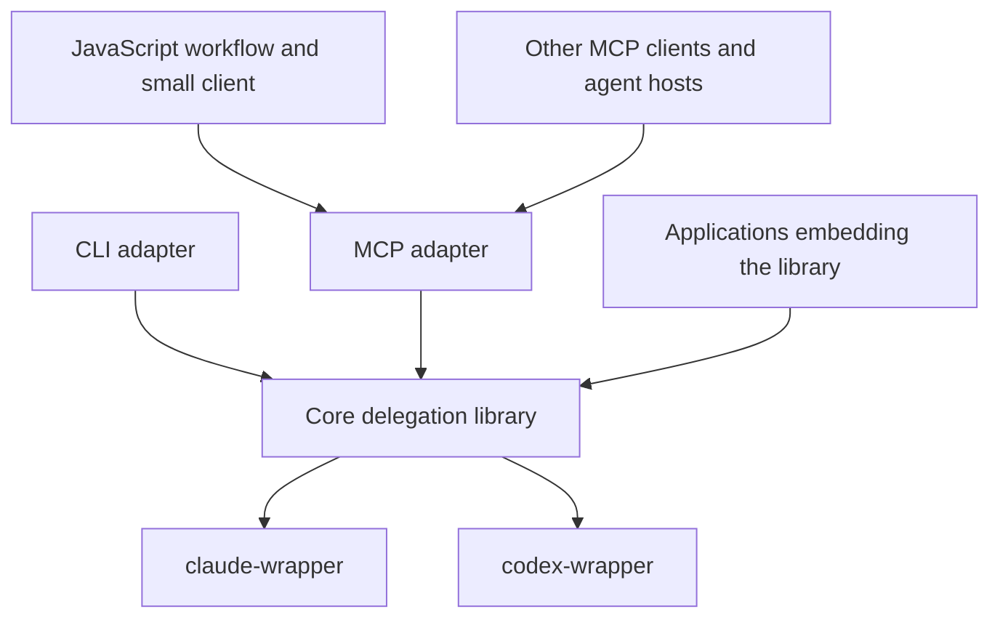

# Core delegation library, CLI, MCP and JavaScript client

Status: selected architectural direction, design draft, 2026-11-04. This is a
documentation-only proposal, not an implemented API or a command-removal notice.
The current supported commands remain documented in [CLI](cli.md), [RPC](rpc.md)
and [JavaScript supervision](harness.md). Runtime changes need a later
implementation and migration pass.

Source map: main `725b8fe6e9e164db0d64c3e12efc84ec18eacc49`. This map excludes
the paused #19 fix in [PR #144](https://github.com/joshrotenberg/due/pull/144).
The older MCP branch at `a715cdd` and multi-session proxy experiment are historical
inputs, not implementations of the interface below. The proxy remains parked in
[#130](https://github.com/joshrotenberg/due/issues/130).

## Architectural boundary

The selected direction has four pieces:

1. A core delegation library above `claude-wrapper` and `codex-wrapper`, owning
   the five functions and provider execution.
2. A foreground CLI for one assignment and one result, including native resume.
3. An MCP adapter exposing the functions, with one scoped engine owning N workers.
4. A small JavaScript client over MCP for workflows in an ordinary JS runtime.

Configuration helpers supply reusable function parameters. Supporting skills and
plugin packaging teach and distribute this interface without owning execution.

JavaScript is a convenience client, not a privileged path or an interpreter
inside Due. Another language can call the same MCP tools with its own client.
Due's custom raw RPC adapter and embedded JavaScript harness are retirement
targets once replacements and migration are ready, rather than additional
supported entry points in the target architecture.



Rust is a natural core implementation because both wrappers are Rust; the
contract is language independent. Library packaging, repository layout and
publication remain undecided. An application could also embed the Rust library
directly, without a protocol. Keep orchestration decisions in the caller.

Three independent choices determine a deployment:

1. **How calls arrive:** direct library calls, CLI arguments or MCP tools.
   JavaScript workflows use the MCP path; they do not require another Due protocol.
2. **Who owns active work:** one invocation, one application/connection scope,
   or an independently running service.
3. **How native context continues:** a new provider process with native resume
   for each turn, or a resident native transport across turns.

MCP does not require resident provider processes. A JavaScript client needs
neither an embedded interpreter nor a custom RPC child. A resident provider
transport does not require a global daemon.

## The five functions

These signatures are pseudocode, not an implemented JS API, schema or CLI syntax.
Calls may be async in a client; starting a run returns after admission rather
than waiting for its assignment to finish.

```ts
spawn(assignment: Assignment) -> RunRef
follow_up(session: SessionInput, assignment: FollowUp) -> RunRef
inspect(run: RunRef) -> RunSnapshot
wait(runs: RunRef[], options: WaitOptions) -> WaitResult
interrupt(run: RunRef) -> RunSnapshot

Assignment = {
  provider: "claude" | "codex",
  prompt: string,
  cwd: string,
  model?: string,
  effort?: string,
  timeout?: Duration,
  ephemeral?: boolean,
  native_options?: ProviderOptions
}
FollowUp = { prompt: string, timeout?: Duration }
WaitOptions = { until: "any" | "all", timeout?: Duration }
WaitResult = { condition_met: boolean, runs: RunSnapshot[] }
```

`ProviderOptions` is explicitly provider specific. Model/effort values must be
validated for the chosen path; portable names do not imply identical behavior.
Existing one-shot answer-schema support must remain available through its
current contract. Whether it becomes a core option or a capability-specific
extension needs a separate decision; resident execution currently rejects it.

### Function semantics

| Function | Proposed behavior |
| --- | --- |
| `spawn` | Validate and admit one assignment in a fresh conversation. No automatic parent-transcript inheritance. Invalid input is rejected before execution; admitted launch/execution failures appear in that run's result. |
| `follow_up` | Start another assignment in an idle conversation, using a live session or a saved native resume descriptor. Reuse the explicit session configuration; do not silently reload a profile or switch provider/workspace. Reject a busy session instead of queueing or interrupting it. |
| `inspect` | Return a non-consuming snapshot. Reading a completed result repeatedly does not change it or release the session. Unknown or expired references fail explicitly. |
| `wait` | Wait on a nonempty set of runs owned by this engine. `any` means at least one is terminal; `all` means all are terminal. Return snapshots for the requested runs. Already-terminal runs count immediately. A wait timeout returns `condition_met: false` and leaves work running. |
| `interrupt` | Request cancellation of the exact run and wait for bounded settlement. A run that already finished returns its original terminal snapshot. Preserve the native outcome and report cleanup failure or unconfirmed settlement explicitly; acknowledgement alone is not completion. |

The assignment deadline and the wait deadline are separate. Cancelling a
client-side wait must not silently cancel its run. An adapter may offer a
foreground convenience that owns and cancels its run when that invocation is
cancelled, but it must document that composition.

An ordinary unsuccessful assignment is result data. Invalid handles, unsupported
operations and communication failures are operation errors. An uncertain spawn
response is not proof that nothing started: do not automatically retry it.
Cancellation never rolls back files or external effects.

### References and results

Keep these identities separate:

| Identity | Lifetime and meaning |
| --- | --- |
| `RunRef` | Engine-owned reference to one assignment; not a PID, native session ID or MCP request ID. |
| `SessionRef` | Engine-owned reference to a logical conversation with fixed provider, canonical cwd and resolved requested configuration. |
| `SavedSession` | Serializable resume candidate containing provider, native session ID, canonical cwd and explicit configuration needed for a later invocation. Available only after the native ID is observed and persistence was requested. It cannot prove the native history is still present. |

`SessionInput` accepts a live `SessionRef` or a `SavedSession`. A saved descriptor
reconstitutes logical context through native resume; it does not reconnect to a
hot process. It cannot reproduce every inherited native setting or live grant.
Native history may be missing or inaccessible, and resumption must fail honestly.
An ephemeral conversation may have a native ID without being resumable.

A snapshot identifies the run, session and provider; its execution state;
available resume information; and its terminal result, if any. Proposed execution
states are `starting`, `running`, `awaiting_input` and `finished`. Reuse the
existing result vocabulary (`succeeded`, `failed`, `timed_out`, `cancelled`) for
terminal outcomes rather than flattening it into a boolean. Preserve available
text, structured output, provenance, usage, diagnostics and settlement evidence.
Execution success remains separate from the caller's acceptance verdict.

The engine can assign its own references before a native session ID exists.
Results are retained independently of later turns, within a documented bound.
Expiration must be observable; neither unlimited history nor cross-process run
handles is promised. This differs from today's latest-turn-only resident state.

Only one assignment may run per logical session within an owner. Several
sessions may run concurrently. Preventing two independent hosts from resuming
the same native history concurrently would need additional coordination; the
core contract alone cannot provide that guarantee.

### Ownership and optional capabilities

Each host owns an engine scope and a bounded collection of active runs and
sessions. The scope must settle owned work on explicit shutdown, including
script failure. Runtime drop is a fallback, not proof of successful cleanup.
A resident native process may remain alive after a run finishes; assignment
completion and session-process shutdown are different events. Exact limits,
retention and shutdown deadlines remain design decisions.

No sixth delegation function is implied by scope teardown. Library scopes,
MCP lifecycle code and the JS client must nevertheless provide an explicit way
to close their owner, release idle resident children and report cleanup failures.

Keep fork, live messaging/steering, full session-item subscriptions and approval
responses as separately specified capabilities. A convenience client cannot
invent them or silently simulate live steering by killing and resuming a run.
Raw native item payloads can remain provider specific with explicit loss bounds.

The baseline needs a deliberate interaction policy. Existing native permission
settings still apply. If an interaction cannot be handled, report it explicitly
and settle according to that policy rather than approve automatically or leave
an unobservable wait. `awaiting_input` does not itself supply an approval API.
Connecting another client, or receiving an agent message, grants no authority.

## Configuration, skills and plugin packaging

The core functions and types represent the interface directly. Configuration
support groups some of their parameters into reusable defaults; it does not
introduce another execution model. Resolve defaults plus explicit overrides into
an assignment before admission and retain the resolved values with the session.

Keep the existing JSON profiles as the portable representation for the CLI and
other clients. The JavaScript client can additionally offer partial-function
helpers: a caller's `review` function captures provider, model, workspace or
native options, then accepts a prompt and explicit overrides. JavaScript config
and functions run in that caller's runtime. MCP carries the resulting JSON
parameters, not executable functions; Due does not load a `.js` config file.

For example, a caller can define a plain function without an additional API:

```js
const review = (prompt, overrides = {}) => due.spawn({
  ...reviewDefaults, ...overrides, prompt,
});
```

Use one authoritative typed validation/merge contract at the core/configuration
boundary. A JS helper can prepare parameters, but must not implement a subtly
different native-policy resolver. Preserve strict JSON intake, duplicate/unknown
field handling, path rules and omitted/null/false semantics. Profile paths sent
to an MCP server refer to its filesystem; a client that loads its own config
must resolve intended paths explicitly. Native resume and resident paths still
need capability validation.

Profiles contain requested configuration, not credentials, actual permission
grants or acceptance rules enforced by Due. A request to review without editing
also needs the appropriate native policy if enforcement is required. Keep
workspace preparation, worker/reviewer routing, independent verification,
revision limits and final acceptance in caller code and skills. Either provider
alone must remain useful.

Skills explain the five functions, when to choose the CLI or MCP, how to write a
self-contained assignment, and how to check results. Reuse the installed-help
and progressive-disclosure approach. Instructions can teach worker/reviewer
patterns without putting those decisions in the core or JS client.

Plugin packaging remains useful for delivering those skills and routing hosts
to help, schemas and, if chosen, MCP setup. It is a distribution/discovery layer,
not another delegation runtime. Whether a plugin bundles MCP registration or
only documents it is a later packaging decision. Do not duplicate execution
logic or install global configuration automatically. CLI users and generic MCP
clients must remain usable without the plugin.

## Runtime profiles in the selected direction

Bidirectional control and a permanent bidirectional stream are different needs.
Inspecting a handle through repeated calls can be sufficient. Receiving a live
approval and returning its decision needs an interaction path, which can use
calls, callbacks or a protocol according to the host.

| Interface | Owner and lifetime | Functions exposed | Continuity and costs |
| --- | --- | --- | --- |
| Foreground CLI | One process for one assignment | Compose `spawn` or `follow_up`, `wait`, then final `inspect`; signals cancel the owned run | Saved native resume across invocations. Lowest runtime commitment; caller task tools can run several invocations concurrently. |
| Scoped MCP | Engine lives across tool calls in a client-owned scope; local stdio is the starting profile | Five tools with engine-owned handles | N workers within that owner. Needs result retention, connection-loss policy and cleanup; no machine-wide registry is implied. |
| JavaScript workflow | Normal JS process uses a small MCP client; it can own a stdio adapter for the workflow's lifetime | Friendly methods over the same five MCP tools | Code uses normal libraries, concurrency and scheduling; Due does not evaluate it. On failure/exit the client closes its owned adapter and observes settlement. |
| Direct library consumer | Application owns the engine | Direct function calls | Application chooses lifetime and UI; no required protocol or interpreter. |

### CLI composition

The current `due run` shape is a good fit for the foreground composition. Normal
stdin prompt intake, stdout result and signals are enough. A later invocation
can follow up using saved native history. OS process forking/detaching is distinct
from forking a model conversation; neither gives the next CLI invocation a live
control channel automatically.

Separate detached `spawn`/`wait`/`inspect` shell commands are outside the selected
scope. They would need durable state, supervision and a control endpoint or
equivalent; a PID file or OS fork alone is insufficient. The CLI need not mirror
every function as a standalone subcommand. The library and MCP provide explicit
control for hosts that need it.

### MCP choices and the meaning of a session

The checked [MCP 2025-11-25 transport specification](https://modelcontextprotocol.io/specification/2025-11-25/basic/transports)
defines stdio as a client-launched child, and Streamable HTTP as an independent
server. A server's protocol connection/session is distinct from a Due engine,
logical worker conversation, native process and run. One connection can address
many worker handles. MCP does not mandate one server instance per agent chat;
host lifecycle and tool concurrency must be checked for the target client.

A scoped stdio adapter owns N conversations while its client is connected.
That is a multi-worker host, but it need not offer a persistent global registry,
cross-client attachment or work that survives its owner. A connection ending
must have an explicit cleanup policy. The [MCP lifecycle](https://modelcontextprotocol.io/specification/2025-11-25/basic/lifecycle)
describes stdio shutdown by closing stdin, waiting, then terminating if needed;
the adapter needs to settle native children within that opportunity.

Streamable HTTP is a possible later MCP transport, not a separate delegation
API or a required initial service deployment. For HTTP, `MCP-Session-Id` is
optional protocol state. It is not a durable job registry; HTTP disconnection
does not itself cancel a request. Choosing to retain
jobs beyond a client connection therefore needs an explicit owner and expiry
policy, rather than assuming that transport resumption guarantees job survival.
See the same [transport specification](https://modelcontextprotocol.io/specification/2025-11-25/basic/transports#session-management).

MCP also has [experimental task support in the checked 2025-11-25 specification](https://modelcontextprotocol.io/specification/2025-11-25/basic/utilities/tasks).
It can wrap long calls with task IDs and deferred result retrieval, but requires
negotiated capabilities and client support. It does not provide Due's native
conversation identity, follow-up semantics or process ownership. Evaluate it
against five ordinary tools returning run handles; do not require it by default.
Cancelling an inspection/wait request should not be confused with cancelling its
underlying run. A blocking start-and-wait tool must state its different policy.

The selected MCP adapter resembles the parked server in owning multiple workers,
with a smaller scope: one caller's engine and cleanup at exit. Shared HTTP
attachment and detached approvals would bring back much of the parked server's
lifecycle complexity. Neither is part of this direction. Native approval prompts
still need an explicit mapping; MCP bidirectionality does not make provider
permissions equivalent or guarantee a host can display/answer them.

### JavaScript workflows over MCP, with no embedding

An ordinary JS program can connect through an MCP client, use N workers, parse
results and choose follow-ups inline. Its runtime supplies imports, libraries,
timers and scheduling. Due needs no interpreter, JS evaluation endpoint, embedded
module system or language-specific bindings. The JS runtime is a prerequisite
only for callers choosing the JS client; it is not required by the Rust CLI or
MCP adapter. Another language needs its own MCP client and runtime, not JS.

The small JS convenience library should expose the same function meanings and
types over standard MCP tool calls. Use an MCP client implementation for protocol
initialization, tool calls and transport handling rather than maintaining another
hand-written JSON-RPC peer. Friendly methods and configuration helpers are
optional: a generic MCP client can discover and invoke the tools directly.
SDK selection, JS runtime version and package publication remain undecided.

For a self-contained workflow, the JS client can launch one stdio MCP child,
which owns one engine and N native workers. No manually started service is
required. The caller owns the MCP process; the core owns its provider processes.
Client scope exit requests shutdown and observes bounded settlement, including
script exceptions. Forced shutdown or lost confirmation must remain explicit.
Functions retained after scope closure reject new work. A normal failed run is
data for the caller to inspect, not an automatic cancellation of every sibling.

If the caller manages the MCP connection itself, connection ownership and
closure belong to it. Helpers must not terminate a server or unrelated jobs
merely because one client object is released. Shared HTTP ownership would need
the separate policy described above.

Illustrative future JS client, not an implemented API or `due script` example:

```js
await withDue({transport: 'stdio', command: dueBinary}, async due => {
  const author = await due.spawn({
    ...implementConfig, provider: 'claude', cwd: worktree, prompt: issueBrief,
  });
  const authored = await due.wait([author], {until: 'all'});
  requireSuccessfulExecution(authored); // Caller-defined; also check actual effects.

  const reviewer = await due.spawn({
    ...reviewConfig, provider: 'codex', cwd: worktree, prompt: independentReviewBrief,
  });
  const reviewed = await due.wait([reviewer], {until: 'all'});
  if (callerRequestsRevision(reviewed)) {
    const session = (await due.inspect(author)).session;
    const revision = await due.follow_up(session, {prompt: revisionBrief});
    requireSuccessfulExecution(await due.wait([revision], {until: 'all'}));
  }
  return callerAcceptanceReport();
});
```

`withDue` describes client/transport scope teardown, not a sixth delegation
operation or another workflow engine. The methods make MCP calls; JS does not
load the Rust library directly. Profile resolution, review independence and
acceptance helpers are caller or configuration support. Parallel assignments
use several `spawn` calls before a `wait`; the core does not choose their order,
roles or providers. No remote script-evaluation MCP tool is needed.

## Mapping what to reuse and what to retire

The executable is currently a binary crate with private modules, not a reusable
core library. `due-harness` is an internal library, but its public host surface
is primarily a bridge to a single RPC child. A library extraction needs deliberate
API/error/ownership work; renaming these modules would not establish the contract.

| Target concern/function | Existing code | Reuse or retirement plan |
| --- | --- | --- |
| Fresh assignment | [`src/main.rs`](../src/main.rs) `run_command`, [`src/providers`](../src/providers/mod.rs), [`src/request.rs`](../src/request.rs) | Reuse one-shot execution, input validation and native argument construction. They currently take CLI types and run to completion; no async engine run handle is published. |
| Resident assignment | [`src/session/mod.rs`](../src/session/mod.rs) `Manager::open/start`, [`claude.rs`](../src/session/claude.rs), [`codex.rs`](../src/session/codex.rs) | Reuse native backends and exact-turn ownership. Open plus first turn could implement spawn, but Manager has one session slot. |
| Follow-up | One-shot `RunArgs.resume`; resident `Manager::start`; [`resume.mjs`](../examples/session-harness/resume.mjs) | Both continuity models exist. Need one explicit SessionInput/configuration contract and native versus engine identity separation. No confirmed normalized fork operation. |
| Inspect | `EventSink::snapshot`, `Manager::read`, [`src/session/items.rs`](../src/session/items.rs) | Reuse state notification, bounded items and loss reporting. Only the latest turn remains in resident state. JS worker wait consumes its result/reservation; proposed inspect does not. |
| Wait | Resident `read(wait_ms)`; [`async.js`](../crates/due-harness/clients/async.js) worker wait | Existing native read wait is at most 10 seconds and can return on events/input. JS wait expiry fails the scope. Neither implements the proposed non-destructive wait-any/all contract. |
| Interrupt | Resident `Manager::interrupt`, provider control owners; one-shot signal/cancellation path | Reuse immutable turn targeting, acknowledgement ownership and bounded cancellation. Current RPC returns acknowledgement before terminal settlement; proposed function must join the run. Resume-based cancellation need not keep a process hot. |
| Configuration/results | [`src/request.rs`](../src/request.rs), [`src/session/profile.rs`](../src/session/profile.rs), [`src/result.rs`](../src/result.rs), [`src/schema.rs`](../src/schema.rs) | Preserve strict JSON, overrides, provenance, results and existing versioned contracts. Separate CLI/transport projections; resident restrictions currently differ from run. |
| MCP adapter | Historical [`src/mcp`](https://github.com/joshrotenberg/due/tree/codex/due-mcp-spike/src/mcp), [`tests/mcp.rs`](https://github.com/joshrotenberg/due/blob/codex/due-mcp-spike/tests/mcp.rs), client examples | Reuse tool-schema/routing/initialization and fixture ideas selectively. The inspected `a715cdd` spike exposes seven resident-session tools, lacks current profile resolution and uses one older Manager slot. Do not merge the branch wholesale or revive its API as the target. MCP dependency choice is a separate decision. |
| Custom wire adapter | [`src/rpc.rs`](../src/rpc.rs) | Retire `due rpc` and its custom public method/transport contract after MCP migration. Reuse lifecycle and budget requirements, not another hand-written protocol in the JS client. |
| Embedded interpreter | [`javascript.rs`](../crates/due-harness/src/javascript.rs), [`clients`](../crates/due-harness/clients/async.js), [`src/script.rs`](../src/script.rs) | Retire `due script`, embedded QuickJS/rquickjs, guest Promise scheduling and embedded JS clients. Port relevant scope/cancellation/result scenarios to core or MCP tests. Normal JS supplies language execution. |
| Child bridge | [`bridge.rs`](../crates/due-harness/src/bridge.rs), [`lib.rs`](../crates/due-harness/src/lib.rs) | Retire the custom JS-to-`due rpc` bridge. Preserve ownership, bounded shutdown and explicit settlement requirements in the MCP owner/client. The new client owns a standard MCP transport, not another provider-process supervisor. |
| Verifier execution | [`supervisor.rs`](../crates/due-harness/src/supervisor.rs) `start/poll/cancel/finish` | Reuse useful job-ownership patterns and process-cleanup regressions in the core where applicable. Retire the product's host-command API with the embedded harness; external workflow code uses its own runtime/libraries to run independent checks. Do not turn arbitrary command execution into a sixth delegation function. |
| Small JS client | [`session.mjs`](../examples/session-harness/session.mjs), [`resident.mjs`](../examples/session-harness/resident.mjs), [`resume.mjs`](../examples/session-harness/resume.mjs) | Reuse scoped lifecycle, identity, profile and failed-execution-as-data lessons. Replace custom framing, cursor pumping and single-worker assumptions with the MCP client and core handles. The supported JS client targets MCP; a selectable resume/raw-RPC client backend is not required. |
| Skills, help and plugin | [`src/skills.rs`](../src/skills.rs), [`embedded-skills`](../embedded-skills), [`src/help.rs`](../src/help.rs), [`plugin/due`](../plugin/due), [`src/init.rs`](../src/init.rs) | Reuse progressive discovery, bounded delegation guidance and setup packaging. Later migrate RPC/script recipes to CLI, MCP and external-client usage together; plugin setup does not implement execution. Preserve current instructions until the replacement exists. |

Tests in [`tests/rpc.rs`](../tests/rpc.rs), [`tests/script.rs`](../tests/script.rs),
[`crates/due-harness/tests`](../crates/due-harness/tests), provider unit tests and
the separate language comparison retain useful scenarios. Map tests by behavior,
including stale interruption, failed settlement and late interaction replies,
rather than preserving an adapter's current restriction as a universal rule.
Retire interpreter-specific and raw-transport-only suites with those products
after porting the applicable behavior. Keep historical comparison evidence;
there is no new Lua or JavaScript embedding comparison to maintain.

External workflow code remains responsible for its own commands, libraries,
effects and permissions. Provider sandbox settings do not constrain the JS host.
Moving checks out of Due does not grant permission to execute worker-proposed
commands or make cleanup an implicit guarantee of arbitrary third-party libraries.

## Selected direction, migration and remaining decisions

**Preserve:** wrapper pins and native tool execution; predictable one-shot
behavior; strict JSON profiles/results; requested versus observed provenance;
deadline/cancellation distinctions; bounds, honest failures and cleanup evidence;
caller-owned policy and useful fake-provider fixtures.

**Selected simplifications:** extract the core functions/types and common
configuration support; keep the CLI as a foreground composition; expose MCP
tools over that same core; provide a small JS client and parameter helpers over
MCP. Replace embedded workflow execution with normal client programs. Keep
portable JSON profiles and supporting skills/plugin packaging. Do not add a
workflow configuration language, custom RPC alternative or remote eval tool.

**Material work, not automatic reuse:** N independently owned worker sessions,
retained per-run snapshots, non-destructive wait-any/all, saved-session import,
scoped shutdown across all workers, and failure isolation between siblings.
The current scope fails as a unit; a multi-worker engine needs an explicit policy
for one worker failing while another is healthy. Caller orchestration chooses
whether to cancel healthy siblings; owner/transport failure may still force cleanup.

**Retirement distinction:** removing Due's custom RPC does not remove native
duplex communication. Claude's `DuplexSession` and Codex's `AppServer` are useful
core-backend candidates. Native CLI/tool execution, permission handling and
stream reads stay in Rust/wrappers. Their lifetimes and optional capabilities
remain independent of MCP's transport lifetime.

A later implementation plan should stage the migration:

1. Extract core/configuration behavior with fake-provider coverage while
   preserving the existing one-shot contracts and wrapper pins.
2. Build the N-worker MCP adapter and small external JS client against the five
   functions. Revalidate the old spike's useful scenarios on current core code.
3. Move examples, help, schemas, embedded skills and plugin guidance together;
   document how old RPC/script callers migrate, including lost/changed semantics.
4. Retire custom RPC and embedded interpreter commands, feature/dependency paths
   and obsolete tests only once the replacement and explicit migration decision
   are ready. Do not copy a stale session implementation merely to save transport
   work, or discard useful cleanup evidence with an obsolete adapter.

This document performs none of those steps. In particular it does not remove
commands, change pins or dependencies, replace installed plugins, resume paused
bug work or close pending issues. Retiring the specific #19 harness path would
not prove concurrent provider spawning in a new N-worker core is safe; retain
the relevant failure mechanism and validate the replacement's ownership boundary.

**Leave undecided:** extracted library packaging/publication; MCP implementation
and JS SDK/package choices; transient versus resident backend defaults; exact
run/result-retention bounds; interaction/event capability shapes; plugin MCP
registration; and any later HTTP deployment. No global registry, cross-client
leases, automatic retries, role routing, worktree management, embedded interpreter
or second custom protocol follows from the selected direction.
