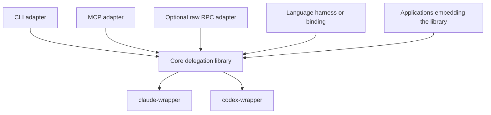

# Core delegation interface and runtime options

Status: design draft, 2026-11-04. No implementation or compatibility change is
authorized by this document. The current supported commands remain documented in
[CLI](cli.md), [RPC](rpc.md) and [JavaScript supervision](harness.md).

Source map: main `725b8fe6e9e164db0d64c3e12efc84ec18eacc49`. This map excludes
the paused #19 fix in [PR #144](https://github.com/joshrotenberg/due/pull/144).
The older MCP branch and multi-session proxy experiment are historical inputs,
not implementations of the interface below. The proxy remains parked in
[#130](https://github.com/joshrotenberg/due/issues/130).

## Architectural boundary

Define a small library-level delegation interface above `claude-wrapper` and
`codex-wrapper`. CLI commands, MCP tools, raw RPC and embedded language bindings
can adapt that interface. A language harness also lets callers compose functions
and interpret results within one execution scope. None of those adapters is a
prerequisite for the library or for another adapter.



This is a logical separation, not a decision to create a repository, publish a
crate, preserve every current transport or support several embedding languages.
Rust is a natural implementation candidate because both wrappers are Rust; the
contract is language independent. Keep orchestration decisions in the caller.

Three independent choices determine a deployment:

1. **How calls arrive:** library calls, CLI arguments, MCP, raw RPC or script
   bindings. Adapters can compose: an MCP tool could evaluate one bounded script.
2. **Who owns active work:** one invocation, one application/connection scope,
   or an independently running service.
3. **How native context continues:** a new provider process with native resume
   for each turn, or a resident native transport across turns.

MCP does not require resident provider processes. A harness does not require a
custom RPC child. A resident provider transport does not require a global daemon.

## The five functions

These signatures are pseudocode, not a new JavaScript API, schema or CLI syntax.
Calls may be async in a binding; starting a run returns after admission rather
than waiting for its assignment to finish.

```ts
spawn(assignment: Assignment) -> RunRef
follow_up(session: SessionInput, assignment: FollowUp) -> RunRef
inspect(run: RunRef) -> RunSnapshot
wait(runs: RunRef[], options: WaitOptions) -> WaitResult
interrupt(run: RunRef) -> RunSnapshot

Assignment = {
  provider: "claude" | "codex",
  prompt: string,
  cwd: string,
  model?: string,
  effort?: string,
  timeout?: Duration,
  ephemeral?: boolean,
  native_options?: ProviderOptions
}
FollowUp = { prompt: string, timeout?: Duration }
WaitOptions = { until: "any" | "all", timeout?: Duration }
WaitResult = { condition_met: boolean, runs: RunSnapshot[] }
```

`ProviderOptions` is explicitly provider specific. Model/effort values must be
validated for the chosen path; portable names do not imply identical behavior.
Existing one-shot answer-schema support must remain available through its
current contract. Whether it becomes a core option or a capability-specific
extension needs a separate decision; resident execution currently rejects it.

### Function semantics

| Function | Proposed behavior |
| --- | --- |
| `spawn` | Validate and admit one assignment in a fresh conversation. No automatic parent-transcript inheritance. Invalid input is rejected before execution; admitted launch/execution failures appear in that run's result. |
| `follow_up` | Start another assignment in an idle conversation, using a live session or a saved native resume descriptor. Reuse the explicit session configuration; do not silently reload a profile or switch provider/workspace. Reject a busy session instead of queueing or interrupting it. |
| `inspect` | Return a non-consuming snapshot. Reading a completed result repeatedly does not change it or release the session. Unknown or expired references fail explicitly. |
| `wait` | Wait on a nonempty set of runs owned by this engine. `any` means at least one is terminal; `all` means all are terminal. Return snapshots for the requested runs. Already-terminal runs count immediately. A wait timeout returns `condition_met: false` and leaves work running. |
| `interrupt` | Request cancellation of the exact run and wait for bounded settlement. A run that already finished returns its original terminal snapshot. Preserve the native outcome and report cleanup failure or unconfirmed settlement explicitly; acknowledgement alone is not completion. |

The assignment deadline and the wait deadline are separate. Cancelling a
client-side wait must not silently cancel its run. An adapter may offer a
foreground convenience that owns and cancels its run when that invocation is
cancelled, but it must document that composition.

An ordinary unsuccessful assignment is result data. Invalid handles, unsupported
operations and communication failures are operation errors. An uncertain spawn
response is not proof that nothing started: do not automatically retry it.
Cancellation never rolls back files or external effects.

### References and results

Keep these identities separate:

| Identity | Lifetime and meaning |
| --- | --- |
| `RunRef` | Engine-owned reference to one assignment; not a PID, native session ID or MCP request ID. |
| `SessionRef` | Engine-owned reference to a logical conversation with fixed provider, canonical cwd and resolved requested configuration. |
| `SavedSession` | Serializable resume candidate containing provider, native session ID, canonical cwd and explicit configuration needed for a later invocation. Available only after the native ID is observed and persistence was requested. It cannot prove the native history is still present. |

`SessionInput` accepts a live `SessionRef` or a `SavedSession`. A saved descriptor
reconstitutes logical context through native resume; it does not reconnect to a
hot process. It cannot reproduce every inherited native setting or live grant.
Native history may be missing or inaccessible, and resumption must fail honestly.
An ephemeral conversation may have a native ID without being resumable.

A snapshot identifies the run, session and provider; its execution state;
available resume information; and its terminal result, if any. Proposed execution
states are `starting`, `running`, `awaiting_input` and `finished`. Reuse the
existing result vocabulary (`succeeded`, `failed`, `timed_out`, `cancelled`) for
terminal outcomes rather than flattening it into a boolean. Preserve available
text, structured output, provenance, usage, diagnostics and settlement evidence.
Execution success remains separate from the caller's acceptance verdict.

The engine can assign its own references before a native session ID exists.
Results are retained independently of later turns, within a documented bound.
Expiration must be observable; neither unlimited history nor cross-process run
handles is promised. This differs from today's latest-turn-only resident state.

Only one assignment may run per logical session within an owner. Several
sessions may run concurrently. Preventing two independent hosts from resuming
the same native history concurrently would need additional coordination; the
core contract alone cannot provide that guarantee.

### Ownership and optional capabilities

Each host owns an engine scope and a bounded collection of active runs and
sessions. The scope must settle owned work on explicit shutdown, including
script failure. Runtime drop is a fallback, not proof of successful cleanup.
A resident native process may remain alive after a run finishes; assignment
completion and session-process shutdown are different events. Exact limits,
retention and shutdown deadlines remain design decisions.

No sixth delegation function is implied by scope teardown. Language scopes and
service lifecycle code must nevertheless provide an explicit way to close the
engine, release idle resident children and report cleanup failures.

Keep fork, live messaging/steering, full session-item subscriptions and approval
responses as separately specified capabilities. A convenience binding cannot
invent them or silently simulate live steering by killing and resuming a run.
Raw native item payloads can remain provider specific with explicit loss bounds.

The baseline needs a deliberate interaction policy. Existing native permission
settings still apply. If an interaction cannot be handled, report it explicitly
and settle according to that policy rather than approve automatically or leave
an unobservable wait. `awaiting_input` does not itself supply an approval API.
Connecting another client, or receiving an agent message, grants no authority.

## JSON profiles and guidance

Keep the existing JSON profile facility as shared configuration support next to
the interface. Resolve a profile plus explicit overrides into an assignment
before admission; retain the resolved values with the session. `review.json`
can therefore act like a partial function without introducing a role router.
File paths, merge/null semantics and provider options need one shared resolver,
with explicit capability validation for resume and resident paths.

Profiles contain requested configuration, not credentials, actual permission
grants or acceptance rules enforced by Due. A request to review without editing
also needs the appropriate native policy if enforcement is required. Keep
workspace preparation, worker/reviewer routing, independent verification,
revision limits and final acceptance in caller code and skills. Either provider
alone must remain useful.

## Runtime profiles by adapter

Bidirectional control and a permanent bidirectional stream are different needs.
Inspecting a handle through repeated calls can be sufficient. Receiving a live
approval and returning its decision needs an interaction path, which can use
calls, callbacks or a protocol according to the host.

| Adapter/profile | Owner and lifetime | Functions exposed | Continuity and costs |
| --- | --- | --- | --- |
| Foreground CLI | One process for one assignment | Compose `spawn` or `follow_up`, `wait`, then final `inspect`; signals cancel the owned run | Saved native resume across invocations. Lowest runtime commitment; caller task tools can run several invocations concurrently. |
| Detached CLI | Worker/supervisor outlives the launching command | Separate commands address `RunRef`s for inspect/wait/interrupt | Requires durable state, process supervision and a control endpoint or equivalent. A PID file or OS fork alone is insufficient. |
| Resident CLI/raw RPC | One explicit owner process across calls | All five through stdio or another endpoint | Natural live control, but the caller must preserve/drain the connection and handle owner failure. Provider processes can still be transient per turn. |
| Blocking MCP tools | One native assignment per tool call; adapter may be long lived | Convenience tool composes start/wait/result; later tool call takes a saved session | Minimal active-job state. Host request deadlines and cancellation matter for long work. |
| Scoped MCP tools | Engine lives across tool calls in a client-owned scope | Five tools with engine-owned handles | N workers within that owner. Needs job retention, connection-loss policy and cleanup; no machine-wide registry is implied. |
| Independent HTTP service | Service owns engines independently of caller connections | Five tools or equivalent endpoints | Adds ownership/authentication, isolation, expiry, reconnect policy and service operation. Detached/reconnecting work is a separate scope decision. |
| Harness run | One script invocation owns one engine and N logical workers | Bindings call all five; script parses results and makes decisions inline | Scope ends after its runs settle. No external interactive stream is necessary for a self-contained workflow; use callbacks/capabilities for interactions if supported. |
| Embedded application/library | Application owns the engine | Direct function calls | Application chooses lifetime and UI; no required protocol or interpreter. |

### CLI choices

The current `due run` shape is a good fit for the foreground composition. Normal
stdin prompt intake, stdout result and signals are enough. A later invocation
can follow up using saved native history. OS process forking/detaching is distinct
from forking a model conversation; neither gives the next CLI invocation a live
control channel automatically.

Separate `spawn`/`wait`/`inspect` shell commands would be a larger product choice.
The owner could be a per-job detached supervisor, an explicit resident child or
a shared service. Each needs a clear authority, cleanup and recovery contract.
Do not add a background service merely to mirror function names as subcommands.

### MCP choices and the meaning of a session

The checked [MCP 2025-11-25 transport specification](https://modelcontextprotocol.io/specification/2025-11-25/basic/transports)
defines stdio as a client-launched child, and Streamable HTTP as an independent
server. A server's protocol connection/session is distinct from a Due engine,
logical worker conversation, native process and run. One connection can address
many worker handles. MCP does not mandate one server instance per agent chat;
host lifecycle and tool concurrency must be checked for the target client.

A scoped stdio adapter could own N conversations while its client is connected.
That is a multi-worker host, but it need not offer a persistent global registry,
cross-client attachment or work that survives its owner. A connection ending
must have an explicit cleanup policy. The [MCP lifecycle](https://modelcontextprotocol.io/specification/2025-11-25/basic/lifecycle)
describes stdio shutdown by closing stdin, waiting, then terminating if needed;
the adapter needs to settle native children within that opportunity.

For HTTP, `MCP-Session-Id` is optional protocol state. It is not a durable job
registry; HTTP disconnection does not itself cancel a request. Choosing to retain
jobs beyond a client connection therefore needs an explicit owner and expiry
policy, rather than assuming that transport resumption guarantees job survival.
See the same [transport specification](https://modelcontextprotocol.io/specification/2025-11-25/basic/transports#session-management).

MCP also has [experimental task support in the checked 2025-11-25 specification](https://modelcontextprotocol.io/specification/2025-11-25/basic/utilities/tasks).
It can wrap long calls with task IDs and deferred result retrieval, but requires
negotiated capabilities and client support. It does not provide Due's native
conversation identity, follow-up semantics or process ownership. Evaluate it
against five ordinary tools returning run handles; do not require it by default.
Cancelling an inspection/wait request should not be confused with cancelling its
underlying run. A blocking start-and-wait tool must state its different policy.

An MCP adapter exposing the five functions directly would resemble the parked
server in owning multiple workers. The scope can be much smaller: one caller's
engine with cleanup at exit. Shared HTTP attachment and detached approvals would
bring back much of the parked server's lifecycle complexity. Neither is required
for MCP discovery and tool invocation alone. Native approval prompts also need
an explicit mapping; MCP bidirectionality does not make provider permissions
equivalent or guarantee a host can display/answer them.

### Harness choices

One harness run can own N workers, make concurrent calls, parse their results
and choose follow-ups without another model round trip for each control step.
Its output can be one caller-defined JSON answer after cleanup. A script may
create and retire workers across several functions; scope ownership must cover
all of them even if a helper throws or returns early.

There are two useful implementation paths to evaluate later:

- **Bindings to the core in the same process:** one Rust engine beneath the
  interpreter; no mandatory child Due binary, JSON-RPC framing or wire recovery
  loop between the script and core. The interpreter still needs async scheduling,
  resource bounds, error translation and cleanup. Same-process integration is
  not automatically less complex in every respect.
- **A script client over an owned process:** preserve process separation and
  independent raw clients, with extra I/O, framing, queue and shutdown machinery.
  A small external-language client can be an alternative to embedding a runtime.

Neither choice requires several supported languages. Existing JavaScript code
is reuse material; this design does not reopen or repeat the Lua comparison.

Illustrative future binding, not a runnable `due script` example:

```js
await withEngine(async engine => {
  const author = await engine.spawn(resolveProfile('implement.json', {
    provider: 'claude', cwd: worktree, prompt: issueBrief,
  }));
  const authored = await engine.wait([author], {until: 'all'});
  requireSuccessfulExecution(authored); // Caller-defined; also check actual effects.

  const reviewer = await engine.spawn(resolveProfile('review.json', {
    provider: 'codex', cwd: worktree, prompt: independentReviewBrief,
  }));
  const reviewed = await engine.wait([reviewer], {until: 'all'});
  if (callerRequestsRevision(reviewed)) {
    const session = (await engine.inspect(author)).session;
    const revision = await engine.follow_up(session, {prompt: revisionBrief});
    requireSuccessfulExecution(await engine.wait([revision], {until: 'all'}));
  }
  return callerAcceptanceReport();
});
```

`withEngine` describes host scope teardown, not a sixth delegation operation.
Profile resolution, review independence and acceptance helpers are caller or
configuration support. Parallel assignments would use several `spawn` calls
before a `wait`; the core need not pick their order, roles or providers.

## Mapping the current implementation

The executable is currently a binary crate with private modules, not a reusable
core library. `due-harness` is an internal library, but its public host surface
is primarily a bridge to a single RPC child. A library extraction needs deliberate
API/error/ownership work; renaming these modules would not establish the contract.

| Proposed concern/function | Existing code | Reuse and mismatch |
| --- | --- | --- |
| Fresh assignment | [`src/main.rs`](../src/main.rs) `run_command`, [`src/providers`](../src/providers/mod.rs), [`src/request.rs`](../src/request.rs) | Reuse one-shot execution, input validation and native argument construction. They currently take CLI types and run to completion; no async engine run handle is published. |
| Resident assignment | [`src/session/mod.rs`](../src/session/mod.rs) `Manager::open/start`, [`claude.rs`](../src/session/claude.rs), [`codex.rs`](../src/session/codex.rs) | Reuse native backends and exact-turn ownership. Open plus first turn could implement spawn, but Manager has one session slot. |
| Follow-up | One-shot `RunArgs.resume`; resident `Manager::start`; [`resume.mjs`](../examples/session-harness/resume.mjs) | Both continuity models exist. Need one explicit SessionInput/configuration contract and native versus engine identity separation. No confirmed normalized fork operation. |
| Inspect | `EventSink::snapshot`, `Manager::read`, [`src/session/items.rs`](../src/session/items.rs) | Reuse state notification, bounded items and loss reporting. Only the latest turn remains in resident state. JS worker wait consumes its result/reservation; proposed inspect does not. |
| Wait | Resident `read(wait_ms)`; [`async.js`](../crates/due-harness/clients/async.js) worker wait | Existing native read wait is at most 10 seconds and can return on events/input. JS wait expiry fails the scope. Neither implements the proposed non-destructive wait-any/all contract. |
| Interrupt | Resident `Manager::interrupt`, provider control owners; one-shot signal/cancellation path | Reuse immutable turn targeting, acknowledgement ownership and bounded cancellation. Current RPC returns acknowledgement before terminal settlement; proposed function must join the run. Resume-based cancellation need not keep a process hot. |
| Configuration/results | [`src/request.rs`](../src/request.rs), [`src/session/profile.rs`](../src/session/profile.rs), [`src/result.rs`](../src/result.rs), [`src/schema.rs`](../src/schema.rs) | Preserve strict JSON, overrides, provenance, results and existing versioned contracts. Separate CLI/transport projections; resident restrictions currently differ from run. |
| Wire adapter | [`src/rpc.rs`](../src/rpc.rs) | Reuse framing, budgets and dispatch tests if raw RPC is retained. Keep wire errors/queues outside the core API. Existing public wire behavior is not changed by this draft. |
| Interpreter/binding | [`javascript.rs`](../crates/due-harness/src/javascript.rs), [`clients`](../crates/due-harness/clients/async.js), [`src/script.rs`](../src/script.rs) | Reuse async evaluation, strict JSON and scope tests selectively. One global client/worker, single-open scope and sticky failures prevent simply adding N worker objects. |
| Child bridge | [`bridge.rs`](../crates/due-harness/src/bridge.rs), [`lib.rs`](../crates/due-harness/src/lib.rs) | Today one Host owns one Bridge that starts `due rpc`, captures raw frames and settles it. Optional for direct bindings; useful if process separation is chosen. |
| Verifier execution | [`supervisor.rs`](../crates/due-harness/src/supervisor.rs) `start/poll/cancel/finish` | Has an owned map of ordinary command jobs, limits and receipts. Useful lifecycle patterns; arbitrary command execution is not a provider-assignment backend and should not become a sixth core function implicitly. |
| External client comparison | [`examples/session-harness`](../examples/session-harness/README.md) | Existing same-workflow resume/RPC comparison informs the two native continuity models. It is an optional client experiment with its own policy, not the new core contract. |

Tests in [`tests/rpc.rs`](../tests/rpc.rs), [`tests/script.rs`](../tests/script.rs),
[`crates/due-harness/tests`](../crates/due-harness/tests), provider unit tests and
the separate language comparison retain useful scenarios. Map tests by behavior,
including stale interruption, failed settlement and late interaction replies,
rather than preserving an adapter's current restriction as a universal rule.

## Reuse, simplify and leave undecided

**Preserve:** wrapper pins and native tool execution; predictable one-shot
behavior; strict JSON profiles/results; requested versus observed provenance;
deadline/cancellation distinctions; bounds, honest failures and cleanup evidence;
caller-owned policy and useful fake-provider fixtures.

**Candidate simplifications:** share an invocation resolver; extract portable
run/result/lifecycle behavior from CLI and RPC types; let each adapter compose
the five functions; make an extra Due child and wire protocol optional for
bindings; separate ordinary host command execution from delegation; keep JSON
profiles and skill guidance rather than adding a workflow configuration language.
These are proposals, not permission to remove working contracts or safeguards.

**Material work, not automatic reuse:** N independently owned worker sessions,
retained per-run snapshots, non-destructive wait-any/all, saved-session import,
scoped shutdown across all workers, and failure isolation between siblings.
The current scope fails as a unit; a multi-worker engine needs an explicit policy
for one worker failing while another is healthy. Caller orchestration chooses
whether to cancel healthy siblings; owner/transport failure may still force cleanup.

**Leave undecided:** extracted library packaging; which adapters to ship;
transient versus resident backend defaults; exact result-retention limits;
interaction/event capability shapes; and whether any detached service is needed.
No global registry, cross-client leases, automatic retries, role routing,
worktree management or second embedded language follows from the five functions.

Evaluate a scoped harness and a foreground CLI against the same core first at
the design level. MCP can expose that core directly, or call a bounded harness
when inline composition is useful. Host lifetime, native process lifetime and
transport lifetime should each be stated independently in any later proposal.
